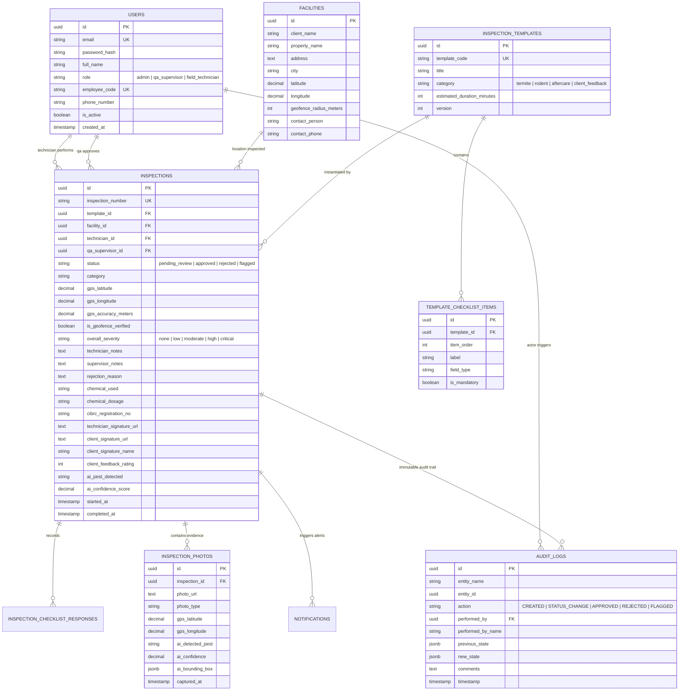

# GlitzUp PestCheck — Database Architecture & Schema Documentation

## 1. System Overview
**GlitzUp PestCheck** operates on a robust relational data model designed for high auditability, strict regulatory compliance (Central Insecticides Board & Registration Committee India, ISO 9001:2015 Quality Management, and ISO 14001:2015 Environmental Safety), and offline-first synchronization from field technicians.

The data layer supports both **PostgreSQL 15+** (for enterprise production deployment on AWS RDS / Supabase) and local lightweight embedded persistence for local development.

---

## 2. Entity Relationship Diagram (ERD)

---

## 3. Detailed Data Dictionary

### 3.1 `users`
Represents all system actors with Role-Based Access Control (RBAC).

| Field | Type | Constraints | Description |
|---|---|---|---|
| `id` | UUID | Primary Key | Unique user identifier |
| `email` | VARCHAR(255) | Unique, Not Null | Login email address |
| `password_hash` | VARCHAR(255) | Not Null | Bcrypt hashed password |
| `full_name` | VARCHAR(150) | Not Null | Official legal name |
| `role` | ENUM | Not Null | `admin`, `qa_supervisor`, `field_technician` |
| `employee_code`| VARCHAR(50) | Unique | E.g. `GZ-TECH-042` |
| `phone_number` | VARCHAR(20) | Nullable | For SMS notification dispatches |
| `is_active` | BOOLEAN | Default TRUE | Soft-disable user access |

### 3.2 `facilities`
Commercial properties, hotels, hospitals, and corporate parks serviced by GlitzUp.

| Field | Type | Constraints | Description |
|---|---|---|---|
| `id` | UUID | Primary Key | Unique facility ID |
| `client_name` | VARCHAR(200) | Not Null | E.g. `ITC Hotels`, `Apollo Hospitals` |
| `property_name`| VARCHAR(200) | Not Null | E.g. `ITC Grand Chola, Guindy` |
| `latitude` | DECIMAL(10, 7) | Not Null | Expected property latitude |
| `longitude` | DECIMAL(10, 7) | Not Null | Expected property longitude |
| `geofence_radius_meters` | INTEGER | Default 150 | Allowed perimeter buffer |

### 3.3 `inspections`
The central compliance record storing live telemetry, evidence, chemical dosages, and signatures.

| Field | Type | Description |
|---|---|---|
| `inspection_number` | VARCHAR(50) | Human-readable tracking code (e.g. `GZ-2026-TK-804`) |
| `status` | ENUM | `pending_review`, `approved`, `rejected`, `flagged_investigation` |
| `gps_latitude` / `gps_longitude` | DECIMAL | Live coordinates stamped at submission |
| `is_geofence_verified` | BOOLEAN | Verified against facility coordinates within geofence |
| `overall_severity` | ENUM | Pest severity assessment (`none`, `low`, `moderate`, `high`, `critical`) |
| `chemical_used` | VARCHAR(200) | Active chemical compound (e.g. `Imidacloprid 30.5% SC`) |
| `cibrc_registration_no`| VARCHAR(100) | CIBRC statutory registration license number |
| `technician_signature_url` | TEXT | Encoded vector/data URL of technician signature |
| `client_signature_url` | TEXT | Encoded vector/data URL of on-site client sign-off |
| `ai_pest_detected` | VARCHAR(100) | AI classification tag (e.g. `Subterranean Termite`) |
| `ai_confidence_score` | DECIMAL(5, 2)| AI vision confidence percentage (e.g. `98.4%`) |

### 3.4 `audit_logs` (Immutable Ledger)
Guarantees audit traceability for regulatory inspections and compliance audits.

| Field | Type | Description |
|---|---|---|
| `entity_name` | VARCHAR(50) | Table or entity affected (`inspections`) |
| `entity_id` | UUID | ID of the affected inspection |
| `action` | VARCHAR(50) | Action performed (`CREATED`, `STATUS_CHANGE`, `APPROVED`, `REJECTED`, `FLAGGED`) |
| `performed_by_name`| VARCHAR(150) | Full name of actor who approved or modified the record |
| `previous_state`| JSONB | Snapshot before change |
| `new_state` | JSONB | Snapshot after change |
| `comments` | TEXT | QA supervisor remarks or rejection reason |
| `timestamp` | TIMESTAMP | Stamped via server clock (UTC) |
